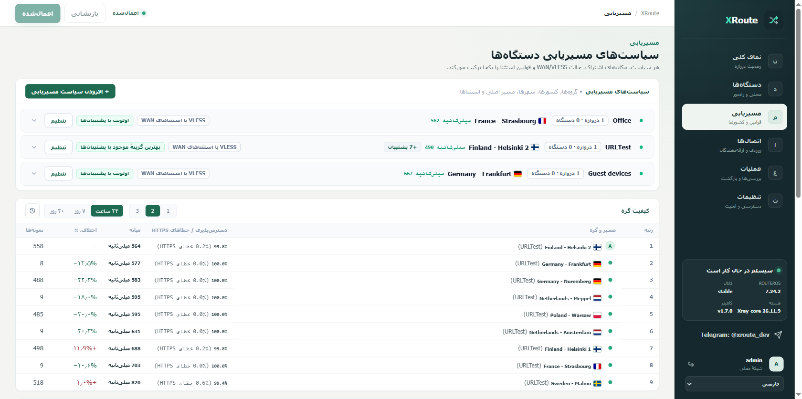

[English](README.md) | [Русский](README-RU.md) | [فارسی](README-FA.md) | [简体中文](README-ZH.md) | [繁體中文](README-ZH-TW.md)

<div dir="rtl">

> برای روترهای OpenWrt، پروژهٔ [XRoute for OpenWrt](https://github.com/Ati054/xroute-openwrt) را ببینید.

# XRoute برای MikroTik RouterOS 7

XRoute را ساختم تا بتوانم مسیریابی پراکسی را روی MikroTik، بدون ویرایش دستی
JSON مدیریت کنم. پنل وب، Xray و ابزارهای مسیریابی را در یک کانتینر
برای روترهای ARM64 فراهم می‌کند.
برای هر دستگاه مسیر انتخاب کنید، سرویس‌های موردنظر را از WAN
عادی بفرستید و در صورت نیاز، سرور پشتیبان اضافه کنید.

این انتشار برای ARM64 ارائه می‌شود. ایمیج x86-64 CHR پس از تکمیل آزمون‌ها، جداگانه منتشر خواهد شد.

[راهنمای نصب](docs/INSTALL.md) · [دریافت](https://github.com/Ati054/xroute/releases/latest)




نماهای زنده از نصب آزمایشی. نام دستگاه‌ها و نشانی‌های IP محلی آزمایشی هستند؛ نشانی‌های عمومی پنهان شده‌اند.

## چه چیزهایی لازم است؟

- یک MikroTik با معماری ARM64، مانند hAP ax³، همراه با RouterOS 7 و پشتیبانی از کانتینر.
- یک دیسک خارجی SSD/USB با فضای کافی برای کانتینر و داده‌های آن.
- اتصال اینترنت و یک اشتراک پراکسی پشتیبانی‌شده یا مسیر خروجی دیگر.
- دامنه و گواهی، اگر اتصال‌های ورودی شما به آن‌ها نیاز دارند. مسیریابی صرفاً خروجی به دامنه نیاز ندارد.

## چه کارهایی انجام می‌دهد؟

- اختصاص مسیر به کلاینت‌های LAN، ‏Wi-Fi و VPNهای پشتیبانی‌شده.
- استفاده از VLESS، ‏Hysteria 2، ‏Reverse VLESS یا تونل‌های انتخاب‌شدهٔ WireGuard در RouterOS به‌عنوان خروجی.
- انتخاب سرور با کمترین تأخیر توسط URLTest، یا حفظ ترتیب اولویت ثابت همراه با پشتیبان‌ها.
- عبور کشورهای انتخاب‌شده، دامنه‌ها و سرویس‌ها از WAN عادی.
- مدیریت اتصال‌های ورودی، گواهی‌های TLS، اشتراک‌ها و پروفایل‌های کلاینت.
- پیش‌نمایش تغییرات پیش از اعمال، مشاهدهٔ گزارش‌ها، پشتیبان‌گیری و به‌روزرسانی کانتینر از پنل.

اتصال ورودی VLESS از WebSocket، ‏gRPC، ‏HTTPUpgrade و XHTTP همراه با TLS،
و نیز اتصال مستقیم REALITY پشتیبانی می‌کند. Hysteria 2 از QUIC/UDP استفاده می‌کند.
[راهنمای معماری](docs/ARCHITECTURE.md)، ترکیب‌های پشتیبانی‌شده و اصلاحیه‌های
Xray مورد استفاده در پروژه را توضیح می‌دهد.

XRoute اشیای RouterOS خود را با برچسب مشخص اضافه می‌کند. تغییر اشیای موجود
به تنظیماتی محدود است که صریحاً انتخاب می‌کنید؛ پیش از نصب، بخش
[یکپارچه‌سازی RouterOS](docs/ROUTEROS.md) را بخوانید.

## نصب

1. بستهٔ RouterOS را از [انتشارها](https://github.com/Ati054/xroute/releases/latest) دریافت و مقدار SHA-256 آن را بررسی کنید.
2. آرشیو کانتینر و پوشهٔ `routeros` را روی SSD خارجی قرار دهید.
3. یک نسخهٔ خصوصی از `routeros/variables.example.rsc` با نام `variables.rsc` بسازید و نشانی‌ها و اطلاعات دسترسی راه‌اندازی اولیه را در آن وارد کنید.
4. فایل `bootstrap.rsc` را از ترمینال MikroTik وارد کنید.
5. پنل را باز کنید، گذرواژهٔ مدیر را بسازید و دستگاه‌ها و مسیرهای خود را تنظیم کنید.

دستورها، پیش‌نیازها و مراحل بازیابی در [راهنمای نصب](docs/INSTALL.md) آمده‌اند.
فایل خصوصی `variables.rsc`، پیوندهای اشتراک یا خروجی پیکربندی خود را در مخزن
عمومی قرار ندهید.

## استفادهٔ روزمره

ویرایش‌ها را ذخیره کنید، تغییرات پیشنهادی را بررسی کنید و سپس Apply را بزنید.
تغییرات محدود به کانتینر از مسیر کوتاه‌تری اعمال می‌شوند؛ تغییرات شبکهٔ
RouterOS با پشتیبان‌گیری و سازوکار بازگشت محافظت می‌شوند. ذخیرهٔ موفق
به‌تنهایی به معنی فعال‌شدن تغییر نیست.

برای گزارش‌ها، پشتیبان‌گیری، بازیابی و به‌روزرسانی تصویر، از بخش **عملیات**
استفاده کنید. به‌روزرسانی‌ها پیکربندی ذخیره‌شدهٔ شما را حفظ می‌کنند. پنل،
عملیات کامل‌شده را از عملیاتی که هنوز در انتظار بازیابی یا تأیید است متمایز می‌کند.

[راهنمای عملیات](docs/OPERATIONS.md)، تغییر مسیر هنگام خرابی، DNS، بازیابی
به‌روزرسانی و محدودیت‌های انتخاب سرور بر اساس تأخیر را توضیح می‌دهد.

## توسعه

کنترلر و ابزارهای RouterOS با Go نوشته شده‌اند. سورس پنل در `app/` است؛
کانتینر خروجی ایستای Next.js را ارائه می‌کند. Vinext/Vite نیز برای توسعهٔ
محلی و پیش‌نمایش Sites استفاده می‌شود؛ بنابراین `next.config.ts` و
`vite.config.ts` به هدف‌های ساخت متفاوتی مربوط‌اند. Vite، پیکربندی Vitest نیست.

<div dir="ltr">

```sh
make validate
go test ./cmd/... ./internal/... ./tests/tools
npm ci --ignore-scripts
npm run lint
npm test
npm run build:static
```

</div>

برای ساخت انتشار و آزمون‌های تکمیلی، [بررسی‌های توسعه](docs/DEVELOPMENT-CHECKS.md)
را بخوانید. CI نمی‌تواند تمام مدل‌های MikroTik یا همهٔ سرورهای خارجی پراکسی
را بازآفرینی کند؛ پس پیش از اتکا به تغییرات، آن‌ها را روی روتر جداگانه آزمایش کنید.

## مستندات

پرسش‌های راه‌اندازی و استفاده را در [Discussions Q&A](https://github.com/Ati054/xroute/discussions/categories/q-a) مطرح کنید.
برای گزارش خطا از [الگوی کوتاه](.github/ISSUE_TEMPLATE/bug_report.md) استفاده کنید و پیوندهای اشتراک، توکن‌ها، کلیدها و اطلاعات شخصی را از گزارش‌ها حذف کنید.

- [نصب](docs/INSTALL.md) · [Установка](docs/INSTALL-RU.md)
- [پنل و تنظیمات](docs/WEB-UI.md)
- [استثناهای منطقه‌ای در WAN](docs/REGIONAL-DIRECT.md)
- [دستگاه‌ها، مسیرها و اشتراک‌ها](docs/CLIENTS.md)
- [عملیات و بازیابی](docs/OPERATIONS.md)
- [عیب‌یابی](docs/TROUBLESHOOTING.md)
- [امنیت](docs/SECURITY.md)
- [تاریخچهٔ تغییرات](CHANGELOG.md)

یادداشت‌های نگهدارنده: [دامنهٔ محصول](docs/internal/PRODUCT.md) و
[طراحی رابط](docs/internal/DESIGN.md).

## مجوز

حق نشر © ۲۰۲۶ [Ati054](https://github.com/Ati054). منتشرشده تحت مجوز
[AGPL-3.0-or-later](LICENSE).

## پرسش‌های متداول

### چگونه مسیریابی گزینشی Xray / VLESS را با پنل وب در MikroTik RouterOS 7 راه‌اندازی کنم؟

کانتینر XRoute را نصب کنید، یک اشتراک اضافه کنید، سیاست مسیریابی بسازید و
دستگاه‌ها را به آن اختصاص دهید. برای سرویس‌هایی که باید مستقیم بمانند، VLESS
با استثناهای WAN را انتخاب کنید؛ برای عبور فقط سرویس‌های انتخاب‌شده از پراکسی،
WAN با استثناهای VLESS را انتخاب کنید. سپس ذخیره و اعمال کنید.
[راهنمای نصب](docs/INSTALL.md) و [راهنمای پنل](docs/WEB-UI.md) را ببینید.

### XRoute برای OpenWrt چه تفاوتی با Podkop و PassWall2 دارد؟

[XRoute for OpenWrt](https://github.com/Ati054/xroute-openwrt) از Xray، کنترلر
Go و LuCI استفاده می‌کند. [Podkop](https://github.com/itdoginfo/podkop)،
sing-box را پیکربندی می‌کند؛ [PassWall2](https://github.com/Openwrt-Passwall/openwrt-passwall2)
از چند هستهٔ پراکسی، از جمله Xray و sing-box، پشتیبانی می‌کند. رابط‌ها و
مدل‌های پیکربندی آن‌ها متفاوت‌اند؛ روش‌های کاری پشتیبانی‌شدهٔ هرکدام را با
نیازهای مسیریابی خود مقایسه کنید.

## انجمن

تلگرام: [@xroute_dev](https://t.me/xroute_dev)

</div>
