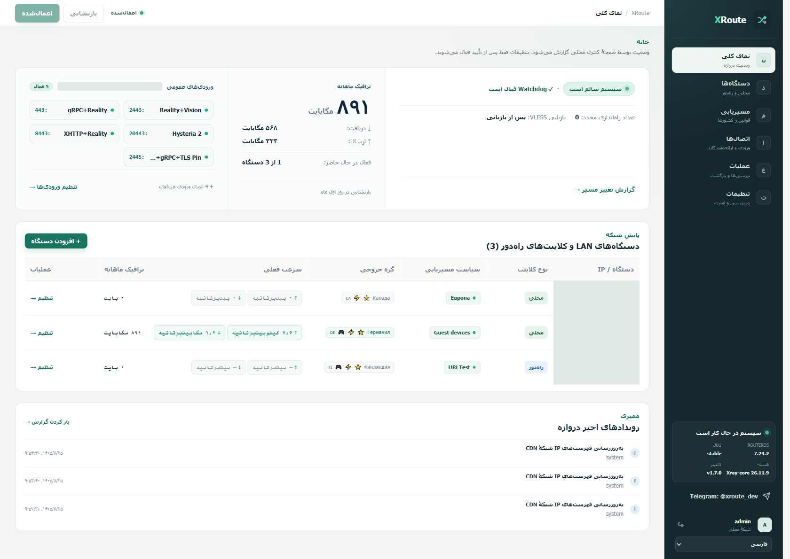

[English](README.md) | [Русский](README-RU.md) | [فارسی](README-FA.md) | [简体中文](README-ZH.md) | [繁體中文](README-ZH-TW.md)

<div dir="rtl">

> برای روترهای OpenWrt، پروژهٔ [XRoute for OpenWrt](https://github.com/Ati054/xroute-openwrt) را ببینید.


# XRoute برای MikroTik RouterOS 7

XRoute را ساختم تا بتوانم مسیریابی پراکسی را روی MikroTik، بدون ویرایش دستی
JSON مدیریت کنم. پنل وب، Xray و ابزارهای مسیریابی را در یک کانتینر
برای روترهای ARM64 و CHR با معماری x86_64 فراهم می‌کند.
برای هر دستگاه مسیر انتخاب کنید، سرویس‌های موردنظر را از WAN
عادی بفرستید و در صورت نیاز، سرور پشتیبان اضافه کنید.

ایمیج‌های ARM64 و AMD64 جداگانه ارائه می‌شوند. در CHR با معماری x86_64، نصب‌کننده می‌تواند از یک پوشه روی دیسک سیستم استفاده کند.

[راهنمای نصب](docs/INSTALL.md) · [دریافت](https://github.com/Ati054/xroute/releases/latest)




نماهای زنده از نصب آزمایشی. نام دستگاه‌ها و نشانی‌های IP محلی آزمایشی هستند؛ نشانی‌های عمومی پنهان شده‌اند.

## چه چیزهایی لازم است؟

- یک MikroTik با معماری ARM64 (مانند hAP ax³) یا CHR با معماری x86_64، همراه با RouterOS 7 و پشتیبانی از کانتینر.
- یک دیسک خارجی SSD/USB برای روتر سخت‌افزاری، یا دیسک CHR با دست‌کم ۱ گیبی‌بایت فضای خالی.
- اتصال اینترنت و یک اشتراک پراکسی پشتیبانی‌شده یا مسیر خروجی دیگر.
- دامنه و گواهی، اگر اتصال‌های ورودی شما به آن‌ها نیاز دارند. مسیریابی صرفاً خروجی به دامنه نیاز ندارد.

## چه کارهایی انجام می‌دهد؟

- اختصاص مسیر به کلاینت‌های LAN، ‏Wi-Fi و VPNهای پشتیبانی‌شده.
- استفاده از VLESS، ‏Hysteria 2، ‏Reverse VLESS یا تونل‌های انتخاب‌شدهٔ WireGuard در RouterOS به‌عنوان خروجی.
- انتخاب سرور با کمترین تأخیر توسط URLTest، یا حفظ ترتیب اولویت ثابت همراه با پشتیبان‌ها.
- عبور کشورهای انتخاب‌شده، دامنه‌ها و سرویس‌ها از WAN عادی.
- مدیریت اتصال‌های ورودی، گواهی‌های TLS، اشتراک‌ها و پروفایل‌های کلاینت.
- پیش‌نمایش تغییرات پیش از اعمال، مشاهدهٔ گزارش‌ها، پشتیبان‌گیری و به‌روزرسانی کانتینر از پنل.

اتصال ورودی VLESS از WebSocket، ‏gRPC، ‏HTTPUpgrade و XHTTP همراه با TLS،
و نیز اتصال مستقیم REALITY پشتیبانی می‌کند. Hysteria 2 از QUIC/UDP استفاده می‌کند.
[راهنمای معماری](docs/ARCHITECTURE.md)، ترکیب‌های پشتیبانی‌شده و اصلاحیه‌های
Xray مورد استفاده در پروژه را توضیح می‌دهد.

XRoute اشیای RouterOS خود را با برچسب مشخص اضافه می‌کند. تغییر اشیای موجود
به تنظیماتی محدود است که صریحاً انتخاب می‌کنید؛ پیش از نصب، بخش
[یکپارچه‌سازی RouterOS](docs/ROUTEROS.md) را بخوانید.

## نصب

1. بستهٔ معماری خود را از [انتشارها](https://github.com/Ati054/xroute/releases/latest) **روی رایانه** دریافت کنید: ARM64 برای روتر سخت‌افزاری و AMD64 برای CHR با معماری x86_64. SHA-256 را بررسی و فایل ZIP را استخراج کنید.
2. **پوشهٔ آمادهٔ `xroute`** را روی SSD خارجی با قالب ext4 (مانند `usb1/xroute/`) یا در ریشهٔ دیسک سیستم CHR (`xroute/`) بارگذاری کنید.
3. در ترمینال MikroTik دستور `/import file-name=usb1/xroute/setup.rsc` را اجرا کنید؛ برای دیسک سیستم CHR از `/import file-name=xroute/setup.rsc` استفاده کنید. محل ذخیره‌سازی و شبکهٔ LAN مورد اعتماد را انتخاب و نصب را تأیید کنید.
4. نشانی پنلی را که نصب‌کننده نمایش می‌دهد باز کنید و راه‌اندازی اولیه را به پایان برسانید.

در این روش **روتر به دسترسی به GitHub نیاز ندارد**. نصب‌کننده گواهی محلی REST و حساب سرویس را می‌سازد و VPNهای موجود را حفظ می‌کند. دستگاه‌های موردنظر را بعداً در پنل به XRoute اختصاص دهید.

دستورها، پیش‌نیازها و مراحل بازیابی در [راهنمای نصب](docs/INSTALL.md) آمده‌اند.
فایل خصوصی `variables.rsc`، پیوندهای اشتراک یا خروجی پیکربندی خود را در مخزن
عمومی قرار ندهید.

## استفادهٔ روزمره

ویرایش‌ها را ذخیره کنید، تغییرات پیشنهادی را بررسی کنید و سپس Apply را بزنید.
تغییرات محدود به کانتینر از مسیر کوتاه‌تری اعمال می‌شوند؛ تغییرات شبکهٔ
RouterOS با پشتیبان‌گیری و سازوکار بازگشت محافظت می‌شوند. ذخیرهٔ موفق
به‌تنهایی به معنی فعال‌شدن تغییر نیست.

برای گزارش‌ها، پشتیبان‌گیری، بازیابی و به‌روزرسانی تصویر، از بخش **عملیات**
استفاده کنید. به‌روزرسانی‌ها پیکربندی ذخیره‌شدهٔ شما را حفظ می‌کنند. پنل،
عملیات کامل‌شده را از عملیاتی که هنوز در انتظار بازیابی یا تأیید است متمایز می‌کند.

[راهنمای عملیات](docs/OPERATIONS.md)، تغییر مسیر هنگام خرابی، DNS، بازیابی
به‌روزرسانی و محدودیت‌های انتخاب سرور بر اساس تأخیر را توضیح می‌دهد.

## توسعه

کنترلر و ابزارهای RouterOS با Go نوشته شده‌اند. سورس پنل در `app/` است؛
کانتینر خروجی ایستای Next.js را ارائه می‌کند. Vinext/Vite نیز برای توسعهٔ
محلی و پیش‌نمایش Sites استفاده می‌شود؛ بنابراین `next.config.ts` و
`vite.config.ts` به هدف‌های ساخت متفاوتی مربوط‌اند. Vite، پیکربندی Vitest نیست.

<div dir="ltr">

```sh
make validate
go test ./cmd/... ./internal/... ./tests/tools
npm ci --ignore-scripts
npm run lint
npm test
npm run build:static
```

</div>

برای ساخت انتشار و آزمون‌های تکمیلی، [بررسی‌های توسعه](docs/DEVELOPMENT-CHECKS.md)
را بخوانید. CI نمی‌تواند تمام مدل‌های MikroTik یا همهٔ سرورهای خارجی پراکسی
را بازآفرینی کند؛ پس پیش از اتکا به تغییرات، آن‌ها را روی روتر جداگانه آزمایش کنید.

## مستندات

پرسش‌های راه‌اندازی و استفاده را در [Discussions Q&A](https://github.com/Ati054/xroute/discussions/categories/q-a) مطرح کنید.
برای گزارش خطا از [الگوی کوتاه](.github/ISSUE_TEMPLATE/bug_report.md) استفاده کنید و پیوندهای اشتراک، توکن‌ها، کلیدها و اطلاعات شخصی را از گزارش‌ها حذف کنید.

- [نصب](docs/INSTALL.md) · [Установка](docs/INSTALL-RU.md)
- [پنل و تنظیمات](docs/WEB-UI.md)
- [استثناهای منطقه‌ای در WAN](docs/REGIONAL-DIRECT.md)
- [دستگاه‌ها، مسیرها و اشتراک‌ها](docs/CLIENTS.md)
- [عملیات و بازیابی](docs/OPERATIONS.md)
- [عیب‌یابی](docs/TROUBLESHOOTING.md)
- [امنیت](docs/SECURITY.md)
- [تاریخچهٔ تغییرات](CHANGELOG.md)

یادداشت‌های نگهدارنده: [دامنهٔ محصول](docs/internal/PRODUCT.md) و
[طراحی رابط](docs/internal/DESIGN.md).

## مجوز

حق نشر © ۲۰۲۶ [Ati054](https://github.com/Ati054). منتشرشده تحت مجوز
[AGPL-3.0-or-later](LICENSE).

## پرسش‌های متداول

### آیا می‌توان فقط دستگاه‌ها یا سرویس‌های مشخصی را از پراکسی عبور داد؟

بله. برای دستگاه‌های شبکهٔ محلی یا همتایان WireGuard، سیاست مسیریابی بسازید.
می‌توانید ترافیک را از پراکسی عبور دهید و برای اتصال مستقیم WAN استثنا تعریف
کنید، یا WAN را مسیر پیش‌فرض نگه دارید و فقط سرویس‌ها و دامنه‌های انتخابی را
به پراکسی بفرستید. [راهنمای نصب](docs/INSTALL.md) و
[راهنمای پنل](docs/WEB-UI.md) را ببینید.

### XRoute کجا ذخیره می‌شود و چه تغییری در شبکهٔ موجود می‌دهد؟

در روترهای سخت‌افزاری، ایمیج کانتینر، پایگاه‌های قواعد و فهرست اشتراک‌ها روی SSD یا حافظهٔ USB خارجی
ذخیره می‌شوند تا فلش داخلی روتر پر یا فرسوده نشود. XRoute اشیای مشخص‌شدهٔ
خود را در RouterOS می‌سازد. تغییر اشیای موجود شبکه به انتخاب صریح در مراحل
نصب یا طرح Apply نیاز دارد؛ تنظیمات LAN و Wi-Fi جایگزین نمی‌شوند. پیش از
تغییرات شبکه، نسخهٔ پشتیبان تهیه و محافظ بازگشت خودکار فعال می‌شود.

### چرا به‌جای تنظیم دستی Xray از XRoute استفاده کنم؟

پنل وب، Xray، هدایت شفاف TCP و UDP با TPROXY، مسیرهای جداگانهٔ DNS با
DoH/DoT، آزمون URLTest و پشتیبانی بر اساس اولویت، به‌روزرسانی محافظت‌شدهٔ
کانتینر و اشتراک کلاینت‌های موبایل، در یک کانتینر قرار دارند. همه را می‌توان
از پنل مدیریت کرد، بدون ویرایش دستی JSON یا نگهداری اسکریپت‌های جداگانهٔ مسیریابی.

## انجمن

تلگرام: [@xroute_dev](https://t.me/xroute_dev)

</div>
