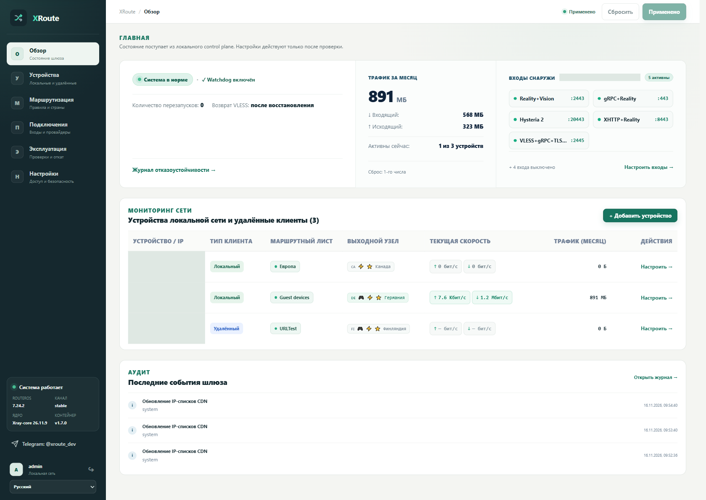

[English](README.md) | [Русский](README-RU.md) | [فارسی](README-FA.md) | [简体中文](README-ZH.md) | [繁體中文](README-ZH-TW.md)


# XRoute для MikroTik RouterOS 7

> **Версия для OpenWrt здесь → [XRoute for OpenWrt](https://github.com/Ati054/xroute-openwrt)**

Я собрал XRoute, чтобы управлять прокси-маршрутизацией на MikroTik без
ручного редактирования JSON. В одном контейнере работают веб-панель,
Xray и инструменты маршрутизации для роутеров ARM64 и x86_64 CHR.
Можно назначить устройствам разные выходы,
оставить нужные сервисы на обычном WAN и добавить резервные серверы.

Доступны отдельные образы ARM64 и AMD64. На x86_64 CHR установщик может использовать каталог на системном диске.

[Установка](docs/INSTALL-RU.md) · [Скачать](https://github.com/Ati054/xroute/releases/latest)




Живые снимки тестовой установки. Имена устройств и локальные IP-адреса тестовые; публичные адреса скрыты.

## Что понадобится

- MikroTik ARM64 (например, hAP ax³) или x86_64 CHR с RouterOS 7 и поддержкой контейнеров.
- Внешний SSD/USB-диск на аппаратном роутере либо диск CHR, на котором свободен хотя бы 1 ГиБ.
- Интернет и подписка с поддерживаемыми прокси-узлами либо другой выход.
- Домен и сертификат, если они нужны входящим подключениям. Для исходящей маршрутизации домен не обязателен.

## Возможности

- Отдельные маршруты для устройств LAN, Wi-Fi и поддерживаемых VPN-клиентов.
- Выход через VLESS, Hysteria 2, Reverse VLESS или выбранные WireGuard-туннели MikroTik.
- Выбор сервера по задержке URLTest либо заданный порядок приоритетов с резервами.
- Прямой WAN для выбранных стран, доменов и сервисов.
- Управление входящими подключениями, TLS-сертификатами, подписками и клиентскими профилями.
- Просмотр изменений перед Apply, журналы, резервные копии и обновление контейнера из панели.

Входящие VLESS-подключения поддерживают WebSocket, gRPC, HTTPUpgrade и XHTTP
с TLS, а также прямой REALITY. Hysteria 2 работает через QUIC/UDP.
Поддерживаемые сочетания и исправления Xray описаны в
[архитектуре проекта](docs/ARCHITECTURE.md).

XRoute создаёт собственные помеченные объекты RouterOS. Изменения
существующих объектов ограничены явно выбранными настройками; перед установкой
прочитайте раздел [интеграции с RouterOS](docs/ROUTEROS.md).

## Установка

1. Скачайте комплект для своей архитектуры из [релизов](https://github.com/Ati054/xroute/releases/latest) **на компьютер**: ARM64 для аппаратного роутера, AMD64 для x86_64 CHR. Проверьте SHA-256 и распакуйте ZIP.
2. Перенесите готовую **папку `xroute`** на внешний ext4 SSD (например, `usb1/xroute/`) либо в корень системного диска CHR (`xroute/`).
3. В терминале MikroTik выполните `/import file-name=usb1/xroute/setup.rsc`, а для системного диска CHR — `/import file-name=xroute/setup.rsc`. Выберите соответствующее хранилище и доверенную LAN, затем подтвердите установку.
4. Откройте панель по адресу, который напечатает установщик, и завершите настройку.

Для этого способа MikroTik **не нужен доступ к GitHub**. Установщик создаёт локальный сертификат REST и служебную учётную запись. Существующие VPN сохраняются; устройства назначаются XRoute позднее в панели.

Команды, требования и порядок восстановления есть в
[руководстве по установке](docs/INSTALL-RU.md). Не публикуйте личный
`variables.rsc`, ссылки подписок и экспорт конфигурации.

## Работа с панелью

Сохраните изменения, проверьте предложенный план и нажмите Apply.
Для изменений только внутри контейнера используется короткий путь.
При изменении сети RouterOS создаются резервная копия и защита отката.
Само сохранение ещё не означает, что настройка уже действует.

В разделе **Эксплуатация** находятся журналы, резервные копии, восстановление
и обновление образа. При обновлении сохранённая конфигурация остаётся.
Панель отдельно показывает завершённые операции и операции, которые ещё ждут
восстановления или подтверждения.

Подробности отказоустойчивости, DNS, обновления и ограничений выбора сервера
по задержке — в [руководстве по эксплуатации](docs/OPERATIONS.md).

## Разработка

Контроллер и инструменты RouterOS написаны на Go. Исходники панели лежат в
`app/`, а контейнер раздаёт статическую сборку Next.js. Vinext/Vite используется
для локальной разработки и предпросмотра Sites. Поэтому `next.config.ts`
и `vite.config.ts` относятся к разным сборкам; Vite здесь не конфигурация Vitest.

```sh
make validate
go test ./cmd/... ./internal/... ./tests/tools
npm ci --ignore-scripts
npm run lint
npm test
npm run build:static
```

Дополнительные проверки и сборка релиза описаны в
[руководстве разработчика](docs/DEVELOPMENT-CHECKS.md). CI не воспроизводит
каждую модель MikroTik и каждый внешний прокси-сервер, поэтому проверяйте
изменения на отдельном роутере.

## Документация

Вопросы по настройке и использованию — в [Discussions Q&A](https://github.com/Ati054/xroute/discussions/categories/q-a).
Об ошибках сообщайте через [короткий шаблон](.github/ISSUE_TEMPLATE/bug_report.md), удалив из лога ссылки подписок, токены, ключи и личные данные.

- [Установка](docs/INSTALL-RU.md) · [Installation](docs/INSTALL.md)
- [Панель и настройки](docs/WEB-UI.md)
- [Региональные исключения WAN](docs/REGIONAL-DIRECT.md)
- [Устройства, маршруты и подписки](docs/CLIENTS.md)
- [Эксплуатация и восстановление](docs/OPERATIONS.md)
- [Диагностика](docs/TROUBLESHOOTING.md)
- [Безопасность](docs/SECURITY.md)
- [История изменений](CHANGELOG.md)

Заметки для разработчиков: [назначение проекта](docs/internal/PRODUCT.md)
и [устройство интерфейса](docs/internal/DESIGN.md).

## Лицензия

Copyright © 2026 [Ati054](https://github.com/Ati054).
Лицензия — [AGPL-3.0-or-later](LICENSE).

## FAQ

### Можно направить через прокси только отдельные устройства или сервисы?

Да. Создайте маршрутный лист для нужных устройств локальной сети или пиров
WireGuard. Можно пустить трафик через прокси с исключениями в прямой WAN либо
оставить WAN основным маршрутом, а через прокси отправлять только выбранные
сервисы и домены. Подробнее — в [установке](docs/INSTALL-RU.md) и
[руководстве по панели](docs/WEB-UI.md).

### Где хранится XRoute и что он меняет в существующей сети?

На аппаратном роутере образ контейнера, базы правил и каталог подписок хранятся на внешнем SSD/USB,
чтобы не заполнять и не изнашивать встроенную флеш-память роутера. XRoute создаёт
помеченные объекты RouterOS. Изменения существующих сетевых объектов требуют
явного выбора при установке или в плане Apply; конфигурация LAN и Wi-Fi не
заменяется. Перед сетевыми изменениями создаётся резервная копия и включается
защита автоматического отката.

### Зачем XRoute, если можно настроить Xray вручную?

В одном контейнере собраны веб-панель, Xray, прозрачный перехват TPROXY для TCP
и UDP, раздельный DoH/DoT DNS, URLTest и приоритет с резервом, защищённое
обновление контейнера и подписки для мобильных клиентов. Всё это можно
настраивать из панели без ручной правки JSON и отдельных скриптов маршрутизации.

## Сообщество

Telegram: [@xroute_dev](https://t.me/xroute_dev)
