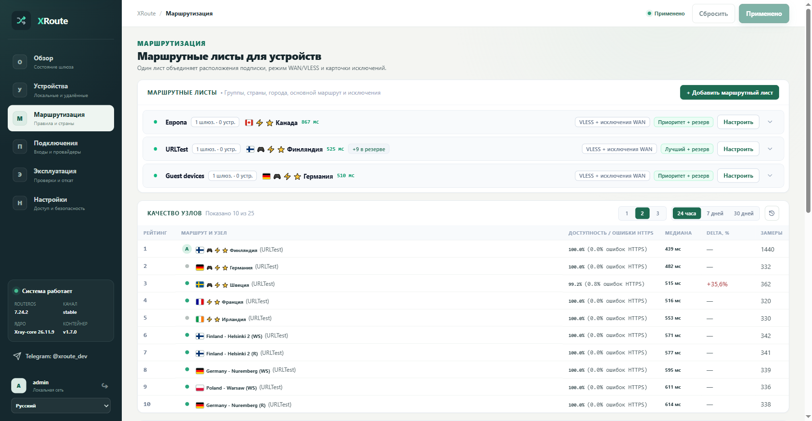

[English](README.md) | [Русский](README-RU.md) | [فارسی](README-FA.md) | [简体中文](README-ZH.md) | [繁體中文](README-ZH-TW.md)

# XRoute для MikroTik RouterOS 7

> **Версия для OpenWrt здесь → [XRoute for OpenWrt](https://github.com/Ati054/xroute-openwrt)**

Я собрал XRoute, чтобы управлять прокси-маршрутизацией на MikroTik без
ручного редактирования JSON. В одном контейнере работают веб-панель,
Xray и инструменты маршрутизации для роутеров ARM64.
Можно назначить устройствам разные выходы,
оставить нужные сервисы на обычном WAN и добавить резервные серверы.

В этом выпуске доступен образ ARM64. Образ для x86-64 CHR выйдет отдельно после завершения проверок.

[Установка](docs/INSTALL-RU.md) · [Скачать](https://github.com/Ati054/xroute/releases/latest)


<details>
<summary>Маршрутизация и качество узлов</summary>



</details>

Скриншоты работающей панели. Сетевые адреса скрыты.

## Что понадобится

- ARM64 MikroTik, например hAP ax³, с RouterOS 7 и поддержкой контейнеров.
- Внешний SSD/USB-диск для контейнера и данных.
- Интернет и подписка с поддерживаемыми прокси-узлами либо другой выход.
- Домен и сертификат, если они нужны входящим подключениям. Для исходящей маршрутизации домен не обязателен.

## Возможности

- Отдельные маршруты для устройств LAN, Wi-Fi и поддерживаемых VPN-клиентов.
- Выход через VLESS, Hysteria 2, Reverse VLESS или выбранные WireGuard-туннели MikroTik.
- Выбор сервера по задержке URLTest либо заданный порядок приоритетов с резервами.
- Прямой WAN для выбранных стран, доменов и сервисов.
- Управление входящими подключениями, TLS-сертификатами, подписками и клиентскими профилями.
- Просмотр изменений перед Apply, журналы, резервные копии и обновление контейнера из панели.

Входящие VLESS-подключения поддерживают WebSocket, gRPC, HTTPUpgrade и XHTTP
с TLS, а также прямой REALITY. Hysteria 2 работает через QUIC/UDP.
Поддерживаемые сочетания и исправления Xray описаны в
[архитектуре проекта](docs/ARCHITECTURE.md).

XRoute создаёт собственные помеченные объекты RouterOS. Изменения
существующих объектов ограничены явно выбранными настройками; перед установкой
прочитайте раздел [интеграции с RouterOS](docs/ROUTEROS.md).

## Установка

1. Скачайте комплект RouterOS из [релизов](https://github.com/Ati054/xroute/releases/latest) и проверьте SHA-256.
2. Поместите архив контейнера и каталог `routeros` на внешний SSD.
3. Создайте личную копию `routeros/variables.example.rsc` под именем `variables.rsc`, укажите адреса и учётные данные первого запуска.
4. Импортируйте `bootstrap.rsc` через терминал MikroTik.
5. Откройте панель, создайте пароль администратора и настройте устройства и маршруты.

Команды, требования и порядок восстановления есть в
[руководстве по установке](docs/INSTALL-RU.md). Не публикуйте личный
`variables.rsc`, ссылки подписок и экспорт конфигурации.

## Работа с панелью

Сохраните изменения, проверьте предложенный план и нажмите Apply.
Для изменений только внутри контейнера используется короткий путь.
При изменении сети RouterOS создаются резервная копия и защита отката.
Само сохранение ещё не означает, что настройка уже действует.

В разделе **Эксплуатация** находятся журналы, резервные копии, восстановление
и обновление образа. При обновлении сохранённая конфигурация остаётся.
Панель отдельно показывает завершённые операции и операции, которые ещё ждут
восстановления или подтверждения.

Подробности отказоустойчивости, DNS, обновления и ограничений выбора сервера
по задержке — в [руководстве по эксплуатации](docs/OPERATIONS.md).

## Разработка

Контроллер и инструменты RouterOS написаны на Go. Исходники панели лежат в
`app/`, а контейнер раздаёт статическую сборку Next.js. Vinext/Vite используется
для локальной разработки и предпросмотра Sites. Поэтому `next.config.ts`
и `vite.config.ts` относятся к разным сборкам; Vite здесь не конфигурация Vitest.

```sh
make validate
go test ./cmd/... ./internal/... ./tests/tools
npm ci --ignore-scripts
npm run lint
npm test
npm run build:static
```

Дополнительные проверки и сборка релиза описаны в
[руководстве разработчика](docs/DEVELOPMENT-CHECKS.md). CI не воспроизводит
каждую модель MikroTik и каждый внешний прокси-сервер, поэтому проверяйте
изменения на отдельном роутере.

## Документация

Вопросы по настройке и использованию — в [Discussions Q&A](https://github.com/Ati054/xroute/discussions/categories/q-a).
Об ошибках сообщайте через [короткий шаблон](.github/ISSUE_TEMPLATE/bug_report.md), удалив из лога ссылки подписок, токены, ключи и личные данные.

- [Установка](docs/INSTALL-RU.md) · [Installation](docs/INSTALL.md)
- [Панель и настройки](docs/WEB-UI.md)
- [Региональные исключения WAN](docs/REGIONAL-DIRECT.md)
- [Устройства, маршруты и подписки](docs/CLIENTS.md)
- [Эксплуатация и восстановление](docs/OPERATIONS.md)
- [Диагностика](docs/TROUBLESHOOTING.md)
- [Безопасность](docs/SECURITY.md)
- [История изменений](CHANGELOG.md)

Заметки для разработчиков: [назначение проекта](docs/internal/PRODUCT.md)
и [устройство интерфейса](docs/internal/DESIGN.md).

## Лицензия

Copyright © 2026 [Ati054](https://github.com/Ati054).
Лицензия — [AGPL-3.0-or-later](LICENSE).

## FAQ

### Как настроить выборочную маршрутизацию Xray / VLESS с веб-панелью на MikroTik RouterOS 7?

Установите контейнер XRoute, добавьте подписку, создайте маршрутный лист и
назначьте ему устройства. Выберите VLESS с исключениями WAN для прямого
доступа к нужным сервисам или WAN с исключениями VLESS для отдельных сервисов.
Сохраните изменения и нажмите Apply. Подробнее: [установка](docs/INSTALL-RU.md)
и [настройка панели](docs/WEB-UI.md).

### Чем XRoute на OpenWrt отличается от Podkop и PassWall2?

[XRoute for OpenWrt](https://github.com/Ati054/xroute-openwrt) использует Xray,
Go-контроллер и LuCI. [Podkop](https://github.com/itdoginfo/podkop) настраивает
sing-box, а [PassWall2](https://github.com/Openwrt-Passwall/openwrt-passwall2)
поддерживает несколько прокси-ядер, включая Xray и sing-box. Интерфейсы и модели
настройки различаются; выбирайте подходящий под ваши задачи маршрутизации.

## Сообщество

Telegram: [@xroute_dev](https://t.me/xroute_dev)
