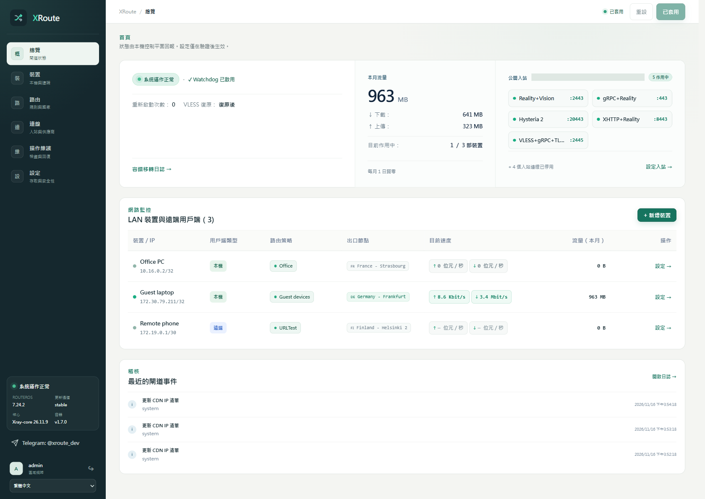
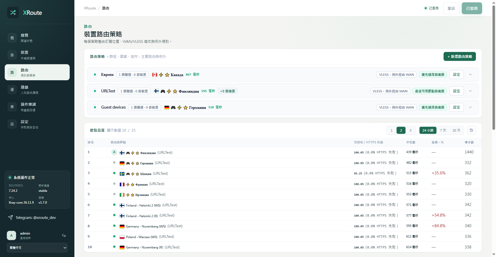

[English](README.md) | [Русский](README-RU.md) | [فارسی](README-FA.md) | [简体中文](README-ZH.md) | [繁體中文](README-ZH-TW.md)

> 使用 OpenWrt？請參閱 [XRoute for OpenWrt](https://github.com/Ati054/xroute-openwrt)。

# 適用於 MikroTik RouterOS 7 的 XRoute

我開發 XRoute，是為了管理 MikroTik 上的代理路由，不必再手動修改 JSON。
它將網頁面板、Xray 與路由工具整合在同一個容器中，提供適用於 ARM64 路由器的映像檔。
您可以為每部裝置選擇路由，讓指定服務經由一般 WAN 連線，
並依需要加入備援伺服器。

目前版本提供 ARM64 映像檔；x86-64 CHR 映像檔將於完成獨立測試後另行發布。

[安裝指南](docs/INSTALL.md) · [下載](https://github.com/Ati054/xroute/releases/latest)





運作中的測試環境截圖。裝置名稱與本機 IP 位址為測試資料，公開位址已隱藏。

## 需要準備什麼

- 支援容器且執行 RouterOS 7 的 ARM64 MikroTik（例如 hAP ax³）。
- 外接 SSD/USB 磁碟，並為容器及其資料保留足夠空間。
- 網際網路連線，以及支援的代理訂閱或其他出口。
- 若入站連線需要，請準備網域與憑證。僅使用出站路由時不需要網域。

## 可以做什麼

- 為 LAN、Wi-Fi 與支援的 VPN 用戶端指定路由。
- 使用 VLESS、Hysteria 2、Reverse VLESS 或指定的 RouterOS WireGuard 通道作為出口。
- 透過 URLTest 選取延遲最低的伺服器，或設定固定的優先順序與備援。
- 讓指定國家、網域與服務維持經由一般 WAN 連線。
- 管理入站連線、TLS 憑證、訂閱與用戶端設定檔。
- 套用前預覽變更，並在面板中檢視日誌、建立備份及更新容器。

VLESS 入站支援搭配 TLS 的 WebSocket、gRPC、HTTPUpgrade 與 XHTTP，
以及直接 REALITY 連線。Hysteria 2 使用 QUIC/UDP。
[架構指南](docs/ARCHITECTURE.md) 說明了支援的組合與專案使用的 Xray 修補。

XRoute 會新增帶有專屬標記的 RouterOS 物件。對既有物件的變更，
僅限於您明確選取的設定；安裝前請先閱讀 [RouterOS 整合](docs/ROUTEROS.md)。

## 安裝

1. 從 [Releases](https://github.com/Ati054/xroute/releases/latest) 下載 RouterOS 套件組，並檢查 SHA-256 校驗碼。
2. 將容器封存檔與 `routeros` 目錄放到外接 SSD。
3. 將 `routeros/variables.example.rsc` 複製為私用的 `variables.rsc`，填入位址與初始設定用的驗證資料。
4. 在 MikroTik 終端機中匯入 `bootstrap.rsc`。
5. 開啟面板，建立管理員密碼，並設定裝置與路由。

完整指令、需求與復原步驟請依照[安裝指南](docs/INSTALL.md)。
請勿將私用的 `variables.rsc`、訂閱連結或匯出的設定放入公開儲存庫。

## 日常使用

編輯後先儲存，檢閱預計執行的變更，再按「套用」。
僅涉及容器的變更會使用較簡短的流程；涉及 RouterOS 網路設定的變更，
則會建立備份並啟用回復保護。成功儲存不代表變更已生效。

在「操作維護」中可使用日誌、備份、復原與映像更新。
更新會保留已儲存的設定。面板會清楚區分已完成的操作，
以及仍在等待復原或確認的操作。

[操作指南](docs/OPERATIONS.md) 說明容錯移轉、DNS、更新復原，
以及依延遲選取伺服器的限制。

## 開發

控制器與 RouterOS 工具以 Go 撰寫。面板原始碼位於 `app/`，
容器提供 Next.js 匯出的靜態檔案。Vinext/Vite 也用於本機開發與 Sites 預覽，
因此 `next.config.ts` 與 `vite.config.ts` 分別服務不同的建置目標。
Vite 設定並不是 Vitest 設定。

```sh
make validate
go test ./cmd/... ./internal/... ./tests/tools
npm ci --ignore-scripts
npm run lint
npm test
npm run build:static
```

發行建置與其他測試請參閱[開發檢查](docs/DEVELOPMENT-CHECKS.md)。
CI 無法重現每一款 MikroTik 或每一台外部代理伺服器，
因此請先在獨立路由器上測試變更，再用於日常連線。

## 文件

設定和使用問題請到 [Discussions Q&A](https://github.com/Ati054/xroute/discussions/categories/q-a) 提問。
回報錯誤請使用[簡短範本](.github/ISSUE_TEMPLATE/bug_report.md)，並從日誌中移除訂閱連結、權杖、金鑰和個人資訊。

- [安裝指南](docs/INSTALL.md) · [Установка](docs/INSTALL-RU.md)
- [面板與設定](docs/WEB-UI.md)
- [區域 WAN 直連規則](docs/REGIONAL-DIRECT.md)
- [裝置、路由與訂閱](docs/CLIENTS.md)
- [操作維護與復原](docs/OPERATIONS.md)
- [疑難排解](docs/TROUBLESHOOTING.md)
- [安全性](docs/SECURITY.md)
- [更新日誌](CHANGELOG.md)

維護者筆記：[產品範圍](docs/internal/PRODUCT.md)與[介面設計](docs/internal/DESIGN.md)。

## 授權

Copyright © 2026 [Ati054](https://github.com/Ati054)。
採用 [AGPL-3.0-or-later](LICENSE) 授權。

## 常見問題

### 可以只讓指定裝置或服務走代理嗎？

可以。為指定的區域網路裝置或 WireGuard 對等端建立路由策略：既可以預設走代理，
將部分服務設為 WAN 直連，也可以預設直連，只讓選定的服務和網域走代理。
詳見[安裝指南](docs/INSTALL.md)與[面板指南](docs/WEB-UI.md)。

##

# XRoute 儲存在哪裡？會改動現有網路嗎？

容器映像檔、規則資料庫和訂閱目錄儲存在外接 SSD 或 USB 儲存裝置上，避免占滿或
耗損路由器內建快閃記憶體。XRoute 會建立帶標記的 RouterOS 物件。只有在安裝過程或
Apply 計畫中明確選取後，才會修改現有網路物件；不會取代 LAN 和 Wi-Fi 設定。
套用網路變更前會建立備份，並啟用自動復原保護。

### 為什麼不直接手動設定 Xray？

XRoute 在單一容器中整合網頁面板、Xray、TCP/UDP 透明代理 TPROXY、分離的
DoH/DoT DNS、URLTest 與依優先順序進行的故障切換、具保護機制的容器更新，
以及行動用戶端訂閱。透過面板即可管理，無須手動編輯 Xray JSON 或維護獨立的路由腳本。

## 社群

Telegram：[@xroute_dev](https://t.me/xroute_dev)
