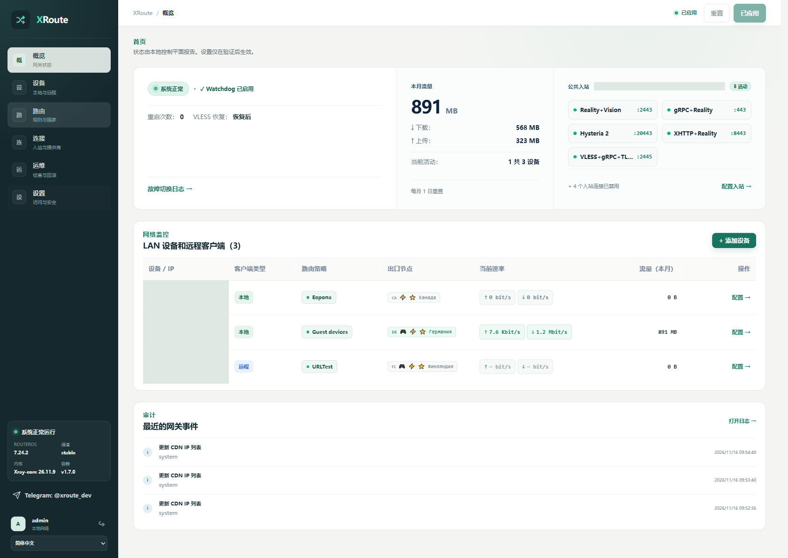
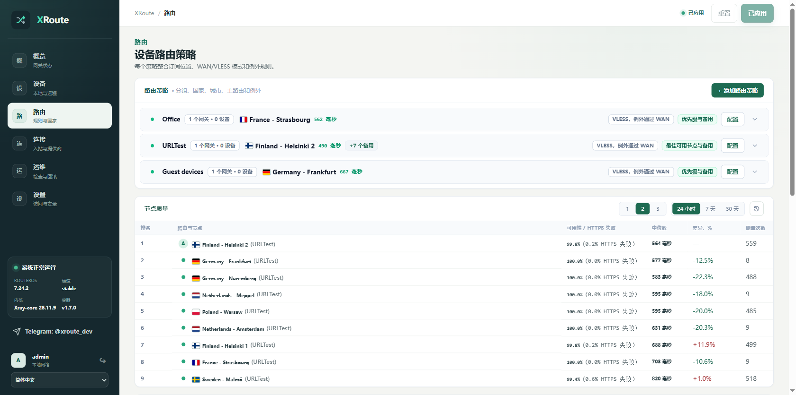

[English](README.md) | [Русский](README-RU.md) | [فارسی](README-FA.md) | [简体中文](README-ZH.md) | [繁體中文](README-ZH-TW.md)

> 使用 OpenWrt？请查看面向该平台的 [XRoute for OpenWrt](https://github.com/Ati054/xroute-openwrt)。


# XRoute · RouterOS 7 原生容器分流，无需旁路由

我开发 XRoute，是为了在 MikroTik 上管理代理路由时，不必再手动编辑 JSON。
它把网页面板、Xray 和路由工具整合进同一个容器，提供适用于 ARM64 路由器的镜像。
你可以为每台设备选择路由，让指定服务走普通 WAN，也可以按需添加备用服务器。

当前版本提供 ARM64 镜像；x86-64 CHR 镜像将在完成独立测试后另行发布。

[安装指南](docs/INSTALL.md) · [下载](https://github.com/Ati054/xroute/releases/latest)





运行中的测试环境截图。设备名称和本地 IP 地址为测试数据，公网地址已隐藏。

## 需要准备什么

- 支持容器并运行 RouterOS 7 的 ARM64 MikroTik（例如 hAP ax³）。
- 外置 SSD/USB 磁盘，并为容器及其数据预留足够空间。
- 互联网连接，以及受支持的代理订阅或其他出口。
- 如果入站连接需要，则准备域名和证书。仅使用出站路由时不需要域名。

## 可以做什么

- 为 LAN、Wi-Fi 及受支持的 VPN 客户端分配路由。
- 使用 VLESS、Hysteria 2、Reverse VLESS，或选定的 RouterOS WireGuard 隧道作为出口。
- 通过 URLTest 选择延迟最低的服务器，或按固定优先级使用主用及备用节点。
- 让指定国家、域名和服务继续走普通 WAN。
- 管理入站连接、TLS 证书、订阅和客户端配置。
- 应用前预览更改，并在面板中查看日志、创建备份和更新容器。

VLESS 入站支持通过 TLS 使用 WebSocket、gRPC、HTTPUpgrade 和 XHTTP，
也支持直接使用 REALITY。Hysteria 2 使用 QUIC/UDP。
[架构指南](docs/ARCHITECTURE.md) 介绍了受支持的组合及项目使用的 Xray 补丁。

XRoute 会创建带有专属标记的 RouterOS 对象。对现有对象的修改仅限于你明确选择的设置。
安装前请阅读 [RouterOS 集成说明](docs/ROUTEROS.md)。

## 安装

1. 在**电脑上**从 [Releases](https://github.com/Ati054/xroute/releases/latest) 下载安装包，核对 SHA-256 后解压。
2. 将准备好的 **`xroute` 文件夹**上传到外接 ext4 SSD，例如 `usb1/xroute/`。
3. 在 MikroTik 终端运行 `/import file-name=usb1/xroute/setup.rsc`，选择磁盘和可信管理 LAN，核对后确认安装。
4. 打开安装程序显示的面板地址，完成首次设置。

此方式**无需路由器访问 GitHub**。安装程序会创建本地 REST 证书和服务账户，保留现有 VPN；稍后在面板中选择需要使用 XRoute 的设备。

具体命令、要求及恢复步骤请参阅[安装指南](docs/INSTALL.md)。
不要将私有 `variables.rsc`、订阅链接或导出的配置放进公开仓库。

## 日常使用

编辑后先保存，检查拟议的更改，再选择“应用”（Apply）。
仅涉及容器的更改使用较短的应用流程；涉及 RouterOS 网络的更改则会创建备份并启用回滚保护。
仅保存成功并不代表更改已经生效。

在**运维**中可以查看日志、管理备份、执行恢复及更新镜像。
更新会保留已保存的配置。面板会区分已经完成的操作，以及仍在等待恢复或确认的操作。

[运维指南](docs/OPERATIONS.md) 介绍了故障切换、DNS、更新恢复，以及按延迟选择服务器的局限。

## CN Direct：国内域名与 IP 直连

在路由策略中选择“VLESS，例外通过 WAN”模式，然后在 WAN 例外规则区域选择
CN（中国）分类，勾选需要直连的服务卡片。

如需让中国 IP 网段也通过 WAN 直连，需另外勾选 GeoIP CN。
保存并点击“应用”（Apply）后，所选规则才会生效。

服务卡片与 GeoIP CN 是两项独立选择。切换界面语言不会自动启用直连规则。

## 开发

控制器和 RouterOS 工具使用 Go 编写。面板源码位于 `app/`，
容器提供 Next.js 静态导出页面。Vinext/Vite 还用于本地开发和 Sites 预览，
因此 `next.config.ts` 和 `vite.config.ts` 分别服务于不同的构建目标。
Vite 配置并非 Vitest 测试配置。

```sh
make validate
go test ./cmd/... ./internal/... ./tests/tools
npm ci --ignore-scripts
npm run lint
npm test
npm run build:static
```

发布构建和其他测试请参阅[开发检查](docs/DEVELOPMENT-CHECKS.md)。
CI 无法复现所有 MikroTik 型号或外部代理服务器，
因此请先在独立路由器上验证更改，再将其用于实际环境。

## 文档

配置和使用问题请到 [Discussions Q&A](https://github.com/Ati054/xroute/discussions/categories/q-a) 提问。
报告错误请使用[简短模板](.github/ISSUE_TEMPLATE/bug_report.md)，并从日志中删除订阅链接、令牌、密钥和个人信息。

- [安装](docs/INSTALL.md) · [俄语安装指南](docs/INSTALL-RU.md)
- [面板与设置](docs/WEB-UI.md)
- [区域 WAN 直连规则](docs/REGIONAL-DIRECT.md)
- [设备、路由与订阅](docs/CLIENTS.md)
- [运维与恢复](docs/OPERATIONS.md)
- [故障排查](docs/TROUBLESHOOTING.md)
- [安全](docs/SECURITY.md)
- [更新日志](CHANGELOG.md)

维护说明：[产品范围](docs/internal/PRODUCT.md)和[界面设计](docs/internal/DESIGN.md)。

## 许可证

版权所有 © 2026 [Ati054](https://github.com/Ati054)。
本项目采用 [AGPL-3.0-or-later](LICENSE) 许可证。

## 常见问题

### 可以只让指定设备或服务走代理吗？

可以。为指定的局域网设备或 WireGuard 对等端创建路由策略：既可以默认走代理，
将部分服务设为 WAN 直连，也可以默认直连，仅让选定的服务和域名走代理。
详见[安装指南](docs/INSTALL.md)和[面板指南](docs/WEB-UI.md)。

### XRoute 存储在哪里？会改动现有网络吗？

容器镜像、规则数据库和订阅目录存储在外接 SSD 或 USB 存储设备上，避免占满或
磨损路由器内置闪存。XRoute 会创建带标记的 RouterOS 对象。只有在安装过程或
Apply 计划中明确选择后，才会修改现有网络对象；不会替换 LAN 和 Wi-Fi 配置。
应用网络变更前会创建备份，并启用自动回滚保护。

### 为什么不直接手动配置 Xray？

XRoute 在一个容器中集成了网页面板、Xray、TCP/UDP 透明代理 TPROXY、分离的
DoH/DoT DNS、URLTest 与按优先级故障切换、带保护的容器更新，以及移动客户端
订阅。通过面板即可管理，无需手动编辑 Xray JSON 或维护单独的路由脚本。

## 社区

Telegram：[@xroute_dev](https://t.me/xroute_dev)
