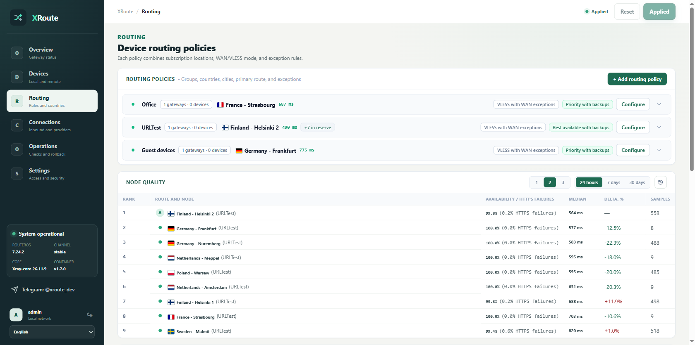

[English](README.md) | [Русский](README-RU.md) | [فارسی](README-FA.md) | [简体中文](README-ZH.md) | [繁體中文](README-ZH-TW.md)

# XRoute for MikroTik RouterOS 7

> **Looking for OpenWrt? → [XRoute for OpenWrt](https://github.com/Ati054/xroute-openwrt)**

I built XRoute so I could manage proxy routing on a MikroTik without editing
JSON by hand. It puts a web panel, Xray and the routing tools in one container,
for ARM64 routers. Choose a route for each
device, send selected services through the
normal WAN, and add backup servers when you need them.

This release provides ARM64 images. The x86-64 CHR build will follow after separate testing.

[Installation](docs/INSTALL.md) · [Downloads](https://github.com/Ati054/xroute/releases/latest)




Live screenshots from a test installation. Device names and local IP addresses are examples; public endpoints are hidden.

## What you need

- An ARM64 MikroTik, such as hAP ax³, with RouterOS 7 and container support.
- An external SSD/USB disk with room for the container and its data.
- An internet connection and a supported proxy subscription or another exit.
- A domain and certificate if your incoming connections need them. Outbound-only routing does not require a domain.

## What it does

- Assign routes to LAN, Wi-Fi and supported VPN clients.
- Use VLESS, Hysteria 2, Reverse VLESS or selected RouterOS WireGuard tunnels as exits.
- Choose the lowest-latency server with URLTest, or keep a fixed priority order with backups.
- Keep selected countries, domains and services on the ordinary WAN.
- Manage incoming connections, TLS certificates, subscriptions and client profiles.
- Preview changes before Apply, view logs, make backups and update the container from the panel.

Incoming VLESS supports WebSocket, gRPC, HTTPUpgrade and XHTTP with TLS,
as well as direct REALITY connections. Hysteria 2 uses QUIC/UDP.
The [architecture guide](docs/ARCHITECTURE.md) describes the supported combinations
and the Xray patches used by the project.

XRoute adds its own marked RouterOS objects. Changes to existing objects
are limited to the settings you explicitly select; see
[RouterOS integration](docs/ROUTEROS.md) before installation.

## Install

1. Download the RouterOS bundle from [Releases](https://github.com/Ati054/xroute/releases/latest) and check its SHA-256 checksum.
2. Put the container archive and the `routeros` directory on the external SSD.
3. Make a private copy of `routeros/variables.example.rsc` as `variables.rsc` and fill in your addresses and bootstrap credentials.
4. Import `bootstrap.rsc` from the MikroTik terminal.
5. Open the panel, create the administrator password and configure your devices and routes.

Follow the [installation guide](docs/INSTALL.md) for the commands, requirements
and recovery steps. Do not put your private `variables.rsc`, subscription links
or exported configuration in a public repository.

## Everyday use

Save your edits, review the proposed changes, then press Apply. Changes confined
to the container use a shorter path; changes to RouterOS networking get a backup
and a rollback guard. A successful save alone does not mean a change is active.

Use **Operations** for logs, backups, recovery and image updates. Updates keep
your saved configuration. The panel distinguishes a completed operation from
one still waiting for recovery or confirmation.

The [operations guide](docs/OPERATIONS.md) explains failover, DNS, update recovery
and the limits of latency-based server selection.

## Development

The controller and RouterOS tools are written in Go. The panel source is in
`app/`; the container serves a static Next.js export. Vinext/Vite is also used
for local development and the Sites preview, so `next.config.ts` and
`vite.config.ts` serve different build targets. Vite is not a Vitest config.

```sh
make validate
go test ./cmd/... ./internal/... ./tests/tools
npm ci --ignore-scripts
npm run lint
npm test
npm run build:static
```

See [development checks](docs/DEVELOPMENT-CHECKS.md) for release builds and
additional tests. CI cannot reproduce every MikroTik model or every external
proxy server, so test changes on a separate router before relying on them.

## Documentation

Use [Discussions Q&A](https://github.com/Ati054/xroute/discussions/categories/q-a)
for setup and usage questions.
Report problems using the [short bug-report template](.github/ISSUE_TEMPLATE/bug_report.md).
Remove subscription URLs, tokens, keys and personal details from logs.

- [Installation](docs/INSTALL.md)
- [Panel and settings](docs/WEB-UI.md)
- [Regional WAN exceptions](docs/REGIONAL-DIRECT.md)
- [Devices, routes and subscriptions](docs/CLIENTS.md)
- [Operations and recovery](docs/OPERATIONS.md)
- [Troubleshooting](docs/TROUBLESHOOTING.md)
- [Security](docs/SECURITY.md)
- [Changelog](CHANGELOG.md)

Maintainer notes: [product scope](docs/internal/PRODUCT.md) and
[interface design](docs/internal/DESIGN.md).

## License

Copyright © 2026 [Ati054](https://github.com/Ati054). Licensed under
[AGPL-3.0-or-later](LICENSE).

## FAQ

### How do I set up selective Xray / VLESS routing with a web panel on MikroTik RouterOS 7?

Install the XRoute container, add a subscription, create a routing policy and
assign devices to it. Choose VLESS with WAN exceptions for services that should
stay direct, or WAN with VLESS exceptions for selected services. Save and Apply.
See the [installation guide](docs/INSTALL.md) and [panel guide](docs/WEB-UI.md).

### How is XRoute for OpenWrt different from Podkop and PassWall2?

[XRoute for OpenWrt](https://github.com/Ati054/xroute-openwrt) uses Xray, a Go
controller and LuCI. [Podkop](https://github.com/itdoginfo/podkop) configures
sing-box; [PassWall2](https://github.com/Openwrt-Passwall/openwrt-passwall2)
supports several proxy cores, including Xray and sing-box. They have different
interfaces and configuration models; compare their supported workflows with
your routing needs.

## Community

Telegram: [@xroute_dev](https://t.me/xroute_dev)
