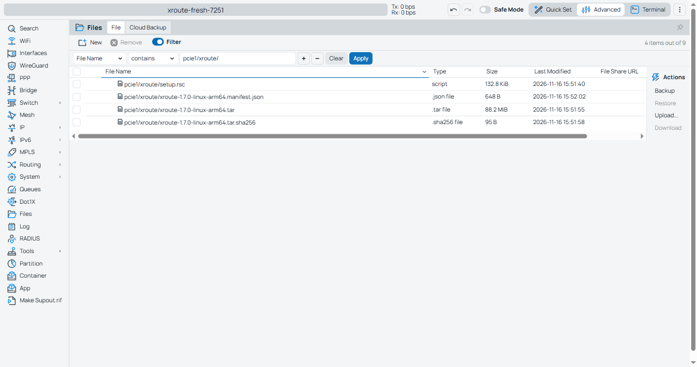

# Установка XRoute 1.7.1

> В новых установках служебные имена начинаются с `XROUTE`. При обновлении
> сохраняются старые имена `SB-GATEWAY` и пути: для такой установки подставляйте
> старый префикс в примеры ниже. Вручную объекты переименовывать не нужно.

В этом выпуске доступен образ ARM64. Сборка для x86-64 CHR проходит отдельные проверки и в эти файлы не входит.

Инструкция описывает первую установку на MikroTik ARM64 с RouterOS 7. Английская
версия находится в [INSTALL.md](INSTALL.md).

## Требования

- MikroTik ARM64 с RouterOS 7 и пакетом `container` той же версии.
- Не менее 512 МиБ RAM, из которых перед установкой свободны 256 МиБ.
- Подключённый ext4 SSD/USB-диск, на котором свободен хотя бы 1 ГиБ
  для распаковки, данных и последующих обновлений.
  Внутреннюю flash-память для контейнера не используйте.
- Проводное подключение компьютера администратора к доверенной management LAN.
- Включённая служба SSH. Для установки через меню служба `www-ssl` должна быть
  выключена, а порт 59443 свободен: локальные сертификаты REST создаст установщик.
  Если HTTPS-доступ уже настроен, используйте ручной способ ниже.
- Файлы релиза из следующего раздела.

До изменения роутера запишите версию и канал RouterOS. Версия пакета
`container` должна совпадать с версией RouterOS.
При проверке служб установщик выбирает статические записи: активные SSH- и
REST-соединения не считаются дубликатами настроек службы.

## Файлы релиза

В комплект входит `container-startup.rsc`:
bootstrap импортирует его перед `install.rsc` для запуска только после
готовности хранилища. Не смешивайте установочные файлы разных релизов;
старые опубликованные комплекты сохраняют прежний порядок запуска.

Скачайте файлы из [релиза 1.7.1](https://github.com/Ati054/xroute/releases/tag/v1.7.1):

- `xroute-1.7.1-routeros-bundle.zip`
- `xroute-1.7.1-routeros-bundle.zip.sha256`

ZIP скачивается и распаковывается **на компьютере**. Доступ MikroTik к GitHub
не требуется. В комплект входят:

- готовая папка `xroute/`: `setup.rsc`, образ `.tar`, его контрольная сумма
  `.sha256` и манифест образа
- каталог `routeros/` для альтернативной ручной установки
- инструкции на русском и английском языках

До распаковки проверьте контрольную сумму комплекта.

PowerShell:

```powershell
(Get-FileHash .\xroute-1.7.1-routeros-bundle.zip -Algorithm SHA256).Hash
Get-Content .\xroute-1.7.1-routeros-bundle.zip.sha256
```

Linux или macOS:

```sh
sha256sum -c xroute-1.7.1-routeros-bundle.zip.sha256
```

После распаковки откройте терминал внутри готовой папки `xroute/` и проверьте
архив контейнера:

```sh
sha256sum -c xroute-1.7.1-linux-arm64.tar.sha256
```

Ожидаемый SHA-256 берите из `.sha256` и manifest того же архива в этом релизе.
Не используйте контрольную сумму другой версии или пересобранного образа.

## Подготовка RouterOS

1. Подключите компьютер администратора кабелем к доверенной management LAN.
   Во время установки сохраните физический доступ к роутеру.
2. Создайте и скачайте binary backup RouterOS и текстовый export без
   чувствительных значений.
3. Проверьте архитектуру и версии пакетов:

   ```routeros
   /system/resource/print
   /system/package/print
   ```

4. Включите container mode. RouterOS может запросить физическое подтверждение и
   перезагрузку:

   ```routeros
   /system/device-mode/update container=yes
   ```

5. Подключите ext4 SSD/USB-диск. Новый диск подготовьте средствами RouterOS,
   предварительно сохранив его содержимое. Установщик диски не форматирует.

## Установка с компьютера

1. Через **Files** в WinBox или WebFig загрузите готовую **папку `xroute`**
   на внешний диск. Для диска `usb1` файлы должны лежать так:

   ```text
   usb1/xroute/
     setup.rsc
     xroute-1.7.1-linux-arm64.tar
     xroute-1.7.1-linux-arm64.tar.sha256
     xroute-1.7.1-linux-arm64.manifest.json
   ```

2. В терминале MikroTik выполните:

   ```routeros
   /import file-name=usb1/xroute/setup.rsc
   ```

   Подставьте имя своего диска. В меню выберите этот же диск и доверенную LAN
   администратора. Проверьте сводку и нажмите **1** для установки. **0** отменяет
   установку до начала изменений.

   

3. Сохраните выданный пароль REST в надёжном месте. Установщик создаёт
   зашифрованную резервную копию, локальные сертификаты HTTPS и служебную
   учётную запись XRoute. В конце он напечатает адрес панели, URL REST и пути
   к публичному сертификату CA и экспорту RouterOS для мастера настройки.
4. Перейдите к разделу [Завершение настройки в Web UI](#завершение-настройки-в-web-ui).

Используется загруженный образ: запросов к GitHub и скачивания образа нет.
Существующие адреса LAN/WAN, DHCP, маршруты по умолчанию и VPN сохраняются.
Список перенаправляемых устройств изначально пуст. Назначьте устройства и
проверьте их маршруты в панели перед Apply.

При несовпадении архитектуры, конфликте адресов или служебных объектов
установщик остановится с объяснением. Установленный XRoute обновляется
через панель, а не повторной установкой поверх.

## Альтернатива: ручная установка

Этот способ нужен при уже настроенном HTTPS-доступе к роутеру или своих
внутренних адресах. **Содержимое** каталога `routeros/`, включая `legacy/`,
разместите рядом с образом. Это отдельный способ: не смешивайте его с `setup.rsc`.

Если `www-ssl` ещё не используется, создайте локальный сертификат. Пример ниже для LAN `192.168.88.0/24` и стандартных адресов контейнера: подставьте свои адреса. Если служба уже работает, сохраните её порт, сертификат и доступ администратора; не выполняйте `set` из примера поверх существующей конфигурации.

```routeros
{
:local awaitCertificate do={
  :local certName $1
  :for attempt from=1 to=60 do={
    :if ([:len [/certificate/get [/certificate/find where name=$certName] fingerprint]] > 0) do={ :return true }
    :delay 1s
  }
  :error ("Certificate signing timed out: " . $certName)
}
/certificate add name=xroute-ca common-name=xroute-ca key-size=2048 days-valid=3650 key-usage=key-cert-sign,crl-sign
/certificate sign xroute-ca
$awaitCertificate "xroute-ca"
/certificate add name=xroute-local common-name=router.lan subject-alt-name=IP:172.31.255.1,DNS:router.lan key-size=2048 days-valid=3650 key-usage=digital-signature,key-encipherment,tls-server
/certificate sign xroute-local ca=xroute-ca
$awaitCertificate "xroute-local"
/ip service set www-ssl certificate=xroute-local port=59443 address=192.168.88.0/24,172.31.255.2/32 disabled=no
}
```

IP в `subject-alt-name` должен совпадать с адресом RouterOS в REST URL. Для поля CA PEM мастера выгрузите **публичный** сертификат: `/certificate export-certificate xroute-ca type=pem`. Приватный ключ не нужен.

### Настройка `variables.rsc`

Скопируйте `routeros/variables.example.rsc` в `variables.rsc`. Не публикуйте
этот файл. Укажите как минимум:

- `SB_IMAGE_FILE`
- `SB_STORAGE_ROOT` и `SB_ROOT_DIR`
- адреса RouterOS, контейнера и TPROXY
- управляемые устройства и внутренние сети
- management-сети и входные интерфейсы
- порт REST RouterOS и имя сертификата
- временный пароль учётной записи RouterOS API

Проверьте каждую примерную сеть. Установите `SB_ADDRESSES_CONFIRMED=true` только
после сверки адресов с конфигурацией роутера. Стандартные пути этого релиза:

```routeros
:global "SB_IMAGE_FILE" "usb1/xroute/xroute-1.7.1-linux-arm64.tar"
:global "SB_ROOT_DIR" "usb1/xroute/root-1.7.1"
```

### Загрузка и ручная установка

Загрузите в один каталог RouterOS следующие файлы:

```text
usb1/xroute/
  legacy/
  bootstrap.rsc
  container-startup.rsc
  cloudflare-update.rsc
  fasttrack-patch.rsc
  install.rsc
  preflight.rsc
  variables.rsc
  watchdog.rsc
  webfig-bootstrap.rsc
  xroute-1.7.1-linux-arm64.tar
```

Копируйте содержимое каталога `routeros/`, а не сам каталог. Файлы
`variables.rsc` и `bootstrap.rsc` должны находиться рядом.

Выполните одну команду в WebFig Terminal:

```routeros
/import file-name=usb1/xroute/bootstrap.rsc
```

Bootstrap проверит комплектность файлов, выполнит preflight, создаст отдельную
учётную запись REST, проверит FastTrack, установит контейнер и watchdog. После
успешного извлечения образа он удалит локальный `.tar`, приватный
`variables.rsc` и одноразовые установочные `.rsc`; `cloudflare-update.rsc`
останется как отдельный необязательный инструмент. До подтверждения готовности
выбранных маршрутов управляемые устройства используют обычный WAN.

Для просмотра сообщений установки выполните:

```routeros
/log/print without-paging where message~"XROUTE"
```

## Завершение настройки в Web UI

Дождитесь состояния контейнера `running` или `healthy`:

```routeros
/container/print detail where comment="XROUTE container"
```

Откройте панель из management LAN. Стандартный адрес:

```text
https://172.31.255.2:9443
```

При первом открытии панели создайте учётную запись администратора. Затем в мастере:

1. загрузите экспорт RouterOS без чувствительных значений;
   создайте его командой `/export file=routeros-export` (без `show-sensitive`);
2. укажите HTTPS URL, имя пользователя, пароль и SSH-порт RouterOS;
3. проверьте адреса контейнера и DNS, выберите сеть доступа к панели и свои сети LAN/VPN;
4. при необходимости добавьте подписку провайдера и имя хоста для клиентских подписок;
5. сохраните черновик, нажмите **Применить**, проверьте список изменений и подтвердите их.

Панель выполнит проверки перед применением. Маршруты, устройства и входящие
подключения можно настроить позже. Подписка провайдера и публичный домен необязательны.

После установки через меню скачайте `routeros-export.rsc` и `routeros-ca.crt`
из папки установки через **Files**. Экспорт загрузите в мастере; публичный
`.crt` откройте как текст и вставьте его содержимое PEM в поле **CA PEM**.
URL REST, имя, пароль и порт SSH возьмите из вывода `setup.rsc`.
Мастер также читает из экспорта выбранные установщиком интерфейс и подсеть
доступа к панели, даже если списка интерфейсов `LAN` нет. Проверьте предложенные
значения: перед применением панель сверит их с текущими настройками RouterOS.
При повторном открытии мастер сохраняет принятые внутренние сети и добавленные
вручную CIDR. Проверка импорта не удаляет сети, настроенные отдельно от мастера,
и не включает отключённые сети.

Сертификат RouterOS защищает HTTPS-соединение панели с REST API роутера.
Он используется отдельно от локального HTTPS-сертификата самой панели и
сертификатов необязательных публичных входов прокси. Для этого локального
соединения управления публичный домен не нужен.

Для работы только клиентом не нужны домен, входящие подключения или публичный
сертификат: имя хоста удалённого доступа оставьте пустым. Для серверного
сценария можно оставить подписку провайдера пустой и настроить её позже.
Существующие VPN-интерфейсы при необходимости выбираются для управления
или доступа клиентов.

При успешном bootstrap приватный `variables.rsc` удаляется автоматически. Если
установка прервалась, удалите его вручную после диагностики. Зашифрованную
автономную копию можно оставить для восстановления.

## Проверка установки

Проверьте контейнер, watchdog и diversion gate:

```routeros
/container/print detail where comment="XROUTE container"
/system/scheduler/print detail where name="XROUTE-health-watchdog"
/ip/firewall/mangle/print detail where comment="XROUTE diversion-gate"
```

Diversion gate может оставаться выключенным, пока не включена политика
устройства и выбранный маршрут не прошёл health-check. Во время запуска и
обновления RouterOS сохраняет обычный WAN. Для устройства с режимом LAN-only
действует выбранная строгая политика отказа.

## Обновление и восстановление

Следующие версии устанавливаются через **Операции → Обновление контейнера**.
В форму загружается новый `.tar` для `linux/arm64`; ZIP комплекта и файл
`.sha256` туда загружать не нужно. Панель проверяет архив и сохраняет прежний
контейнер до завершения probation нового образа.

Резервное копирование, rollback, восстановление и удаление описаны в
[OPERATIONS.md](OPERATIONS.md). Ошибки preflight и readiness разобраны в
[TROUBLESHOOTING.md](TROUBLESHOOTING.md).
