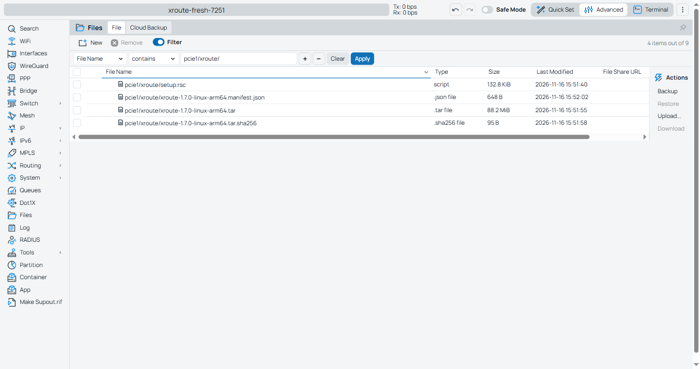

# Install XRoute 1.7.0

> New installations use `XROUTE` ownership labels. Upgraded installations keep
> `SB-GATEWAY` labels and their existing paths; use that prefix in the examples
> below for an older installation. Never rename these objects manually.

This release provides ARM64 images. The x86-64 CHR build is being tested separately and is not included in these downloads.

This guide covers the first installation on an ARM64 MikroTik running
RouterOS 7. Use the matching Russian guide if needed:
[INSTALL-RU.md](INSTALL-RU.md).

## Requirements

- ARM64 MikroTik with RouterOS 7 and the matching `container` package.
- At least 512 MiB RAM, with 256 MiB free before installation.
- A mounted ext4 SSD/USB disk with at least 1 GiB free for extraction,
  data and later image updates.
  Do not place the container on internal flash.
- Wired access from an administrator computer on a trusted management LAN.
- An enabled SSH service. For guided installation, `www-ssl` must be unused
  and TCP 59443 available; the installer creates the local REST certificates.
  If HTTPS management is already configured, use the manual method below.
- The release files listed below.

Record the current RouterOS version and channel before changing the router.
The `container` package version must match RouterOS.
Installer service checks select static listeners; active SSH or REST sessions
are not treated as duplicate service configuration.

## Release files

Download the assets from [release 1.7.0](https://github.com/Ati054/xroute/releases/tag/v1.7.0):

- `xroute-1.7.0-routeros-bundle.zip`
- `xroute-1.7.0-routeros-bundle.zip.sha256`

The ZIP is downloaded and extracted **on your computer**. The router does not
need GitHub access. It contains:

- a ready `xroute/` folder containing `setup.rsc`, the container `.tar`,
  its `.sha256` checksum and the image manifest
- `routeros/` scripts for the alternative manual installation
- this installation guide in English and Russian

Verify the bundle before extracting it.

PowerShell:

```powershell
(Get-FileHash .\xroute-1.7.0-routeros-bundle.zip -Algorithm SHA256).Hash
Get-Content .\xroute-1.7.0-routeros-bundle.zip.sha256
```

Linux or macOS:

```sh
sha256sum -c xroute-1.7.0-routeros-bundle.zip.sha256
```

After extraction, open a terminal inside the ready `xroute/` folder and
verify the container archive too:

```sh
sha256sum -c xroute-1.7.0-linux-arm64.tar.sha256
```

Use the expected SHA-256 from the matching archive's `.sha256` file and manifest
in this release. Do not use a checksum from another version or rebuild.

## Prepare RouterOS

1. Connect the administrator computer by Ethernet to the trusted management
   LAN. Keep local physical access to the router during installation.
2. Create and download a RouterOS binary backup and a text export without
   sensitive values.
3. Confirm the RouterOS architecture and package versions:

   ```routeros
   /system/resource/print
   /system/package/print
   ```

4. Enable container mode. RouterOS may require a physical confirmation and a
   reboot:

   ```routeros
   /system/device-mode/update container=yes
   ```

5. Connect an ext4 SSD/USB disk. Prepare a new disk using RouterOS storage tools
   only after saving anything it contains. The installer never formats disks.

## Install from your computer

1. In WinBox or WebFig **Files**, upload the ready **`xroute` folder** onto
   the external disk. For a disk named `usb1`, the result must be:

   ```text
   usb1/xroute/
     setup.rsc
     xroute-1.7.0-linux-arm64.tar
     xroute-1.7.0-linux-arm64.tar.sha256
     xroute-1.7.0-linux-arm64.manifest.json
   ```

2. In the MikroTik terminal, run:

   ```routeros
   /import file-name=usb1/xroute/setup.rsc
   ```

   Substitute the actual disk name. Choose the same disk in the menu, choose
   your trusted administrator LAN, review the summary and press **1** to install.
   Press **0** to cancel before installation starts.

   

3. Save the generated REST password privately. The installer creates an encrypted
   pre-install backup, local HTTPS certificates and the XRoute service account.
   It prints the panel address, REST URL and paths to the public CA certificate
   and RouterOS export used by the setup wizard.
4. Continue at [Finish setup in the Web UI](#finish-setup-in-the-web-ui).

The uploaded image is used locally; no release lookup or download is performed.
Existing LAN/WAN addresses, DHCP, default routes and VPNs remain in place.
Client diversion starts with an empty device list. Select devices and review
their routes in the panel before Apply.

Wrong architecture, conflicting addresses or existing installation objects stop
the installer with an explanation. An existing XRoute installation is updated
from its panel, rather than installed over again.

## Alternative: manual installation

Use this method for an existing HTTPS management service or custom internal
addressing. Copy the **contents** of `routeros/`, including `legacy/`, beside the
container archive. This is a separate method; do not mix it with `setup.rsc`.

If `www-ssl` is not already in use, create a local certificate. The example below assumes LAN `192.168.88.0/24` and the default container network; substitute your actual addresses. If the service is already in use, retain its port, certificate and administrator access instead of overwriting it with this example.

```routeros
{
:local awaitCertificate do={
  :local certName $1
  :for attempt from=1 to=60 do={
    :if ([:len [/certificate/get [/certificate/find where name=$certName] fingerprint]] > 0) do={ :return true }
    :delay 1s
  }
  :error ("Certificate signing timed out: " . $certName)
}
/certificate add name=xroute-ca common-name=xroute-ca key-size=2048 days-valid=3650 key-usage=key-cert-sign,crl-sign
/certificate sign xroute-ca
$awaitCertificate "xroute-ca"
/certificate add name=xroute-local common-name=router.lan subject-alt-name=IP:172.31.255.1,DNS:router.lan key-size=2048 days-valid=3650 key-usage=digital-signature,key-encipherment,tls-server
/certificate sign xroute-local ca=xroute-ca
$awaitCertificate "xroute-local"
/ip service set www-ssl certificate=xroute-local port=59443 address=192.168.88.0/24,172.31.255.2/32 disabled=no
}
```

The IP in `subject-alt-name` must match the RouterOS address in the REST URL. For the wizard's CA PEM field, export the **public** certificate: `/certificate export-certificate xroute-ca type=pem`. No private key is needed.

### Configure `variables.rsc`

Copy `routeros/variables.example.rsc` to `variables.rsc`. Keep this file
private. Set at least the following values:

- `SB_IMAGE_FILE`
- `SB_STORAGE_ROOT` and `SB_ROOT_DIR`
- router, container, and TPROXY addresses
- managed clients and internal networks
- management source networks and ingress interfaces
- RouterOS REST port and certificate name
- temporary RouterOS API password

Review every example network. Set `SB_ADDRESSES_CONFIRMED=true` only after the
addresses match the router. The default image and root paths for this release
are:

```routeros
:global "SB_IMAGE_FILE" "usb1/xroute/xroute-1.7.0-linux-arm64.tar"
:global "SB_ROOT_DIR" "usb1/xroute/root-1.7.0"
```

### Upload and install manually

Upload these files to the same RouterOS directory:

```text
usb1/xroute/
  legacy/
  bootstrap.rsc
  container-startup.rsc
  cloudflare-update.rsc
  fasttrack-patch.rsc
  install.rsc
  preflight.rsc
  variables.rsc
  watchdog.rsc
  webfig-bootstrap.rsc
  xroute-1.7.0-linux-arm64.tar
```

Copy the contents of the bundle's `routeros/` directory, not the directory
itself. Keep `variables.rsc` beside `bootstrap.rsc`.

The bundle requires `container-startup.rsc`.
Bootstrap imports it before `install.rsc` to install storage-aware
container startup. Do not mix installer files from different releases:
the published older bundles retain their original startup behavior.

Run one command in WebFig Terminal:

```routeros
/import file-name=usb1/xroute/bootstrap.rsc
```

The bootstrap script checks every required file before making changes. It then
runs preflight, creates the dedicated REST account, checks FastTrack, installs
the container, and creates the health watchdog. After the image is extracted
successfully, it removes the local `.tar`, private `variables.rsc`, and one-shot
installer `.rsc` files; `cloudflare-update.rsc` remains as a separate optional
tool. Managed clients continue to use the normal WAN until their selected routes
pass readiness checks.

Follow installation messages if needed:

```routeros
/log/print without-paging where message~"XROUTE"
```

## Finish setup in the Web UI

Wait for the container to reach `running` or `healthy`:

```routeros
/container/print detail where comment="XROUTE container"
```

Open the panel from the management LAN. The default address is:

```text
https://172.31.255.2:9443
```

The first-launch wizard asks you to:

1. create the panel administrator account;
2. upload a current RouterOS export without sensitive values;
   create it with `/export file=routeros-export` (without `show-sensitive`);
3. confirm the RouterOS, container, TPROXY, and DNS addresses;
4. select trusted LAN and VPN interfaces;
5. store RouterOS REST credentials in the encrypted secret store;
6. configure routes, nodes, certificates, and client policies;
7. run Check and review the generated plan before Apply.

For guided installation, download `routeros-export.rsc` and `routeros-ca.crt`
from the installation folder in **Files**. Upload the export in the wizard;
open the public `.crt` as text and paste its PEM contents into **CA PEM**.
Use the REST URL, username, password and SSH port printed by `setup.rsc`.
The wizard also reads the installer's selected management interface and CIDR
from the export, even without a RouterOS `LAN` interface list. These are review
suggestions; live preflight still verifies the current configuration before Apply.

The RouterOS certificate protects the panel's HTTPS REST connection to the
router. It is separate from the panel's own local HTTPS certificate and from
certificates for optional public proxy listeners. No public domain is needed
for this local management connection.

Outbound-only use does not require a domain, an inbound listener or a public
certificate. Leave the remote-access hostname empty. For server-only use,
the provider subscription can be left empty and configured later. Existing
VPN interfaces can be selected for management or client access when needed.

Successful bootstrap removes the private `variables.rsc` automatically. If the
installation stops early, remove it manually after diagnosis. Keep an encrypted
offline copy if you need it for recovery.

## Verify the installation

Check the container, watchdog, and diversion gate:

```routeros
/container/print detail where comment="XROUTE container"
/system/scheduler/print detail where name="XROUTE-health-watchdog"
/ip/firewall/mangle/print detail where comment="XROUTE diversion-gate"
```

The diversion gate can remain disabled until you enable a client policy and the
selected route passes health checks. RouterOS keeps ordinary WAN routing
available during startup and image update. A client configured for LAN-only
outage handling keeps that stricter policy.

## Update and recovery

Use **Operations → Container image update** for later releases. Upload the new
`linux/arm64` `.tar`; do not upload the release ZIP or the `.sha256` file into
the update form. The panel verifies the archive and retains the previous
container until the new image passes probation.

See [OPERATIONS.md](OPERATIONS.md) for backup, recovery, rollback, and removal.
Use [TROUBLESHOOTING.md](TROUBLESHOOTING.md) if preflight or readiness fails.
